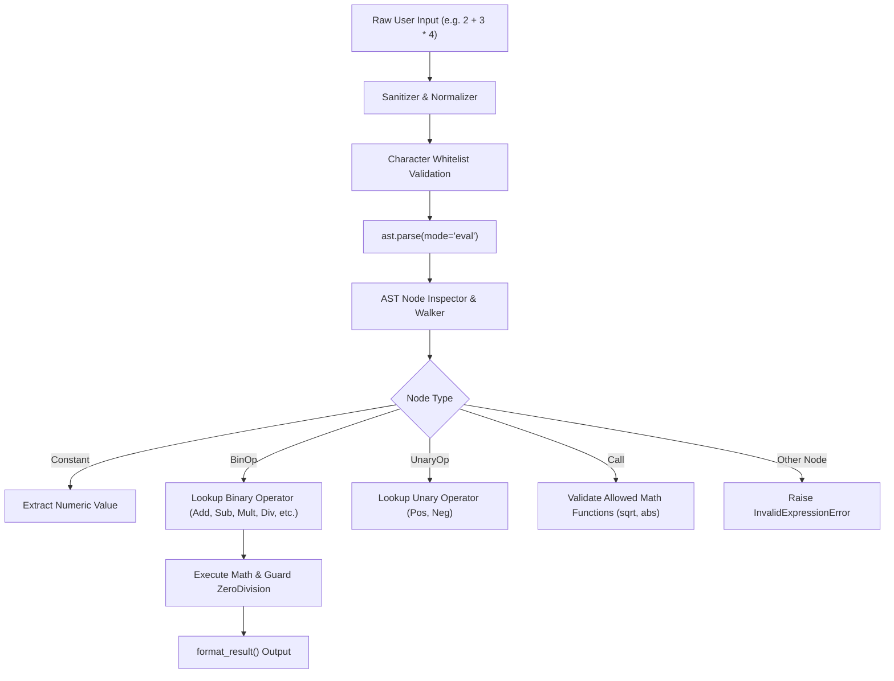

# Auspify Calculator Pro

**Auspify Technologies — Python Development Internship**  
*Task 3: Modern Desktop GUI & Command-Line Calculator Application*

---

## 📌 Project Overview

**Auspify Calculator Pro** is a modern, high-precision desktop and terminal calculator developed in Python. Designed to combine visual elegance with cryptographic-grade execution safety, the application provides a responsive graphical user interface (GUI) built with **Tkinter** alongside a full-featured interactive **Command-Line Interface (CLI)**.

Many beginner calculator implementations unsafely invoke Python's built-in `eval()` function to parse mathematical strings. In production environments, `eval()` represents a critical **Remote Code Execution (RCE)** vulnerability, allowing malicious inputs (such as `__import__('os').system(...)`) to execute arbitrary operating system commands. 

To eliminate this vulnerability entirely, this application implements a custom **Abstract Syntax Tree (AST) Parser and Evaluator** (`calculator_core.py`). Expressions are tokenized and parsed into a formal mathematical syntax tree using Python's standard `ast` library. Only strictly whitelisted arithmetic nodes (`Add`, `Sub`, `Mult`, `Div`, `Pow`, `Mod`, `UnaryOp`, and permitted math functions) are evaluated, guaranteeing complete isolation and safety.

---

## ✨ Key Features

1. **Safe AST-Based Expression Evaluation:**
   - Strictly replaces dangerous `eval()` with an explicit AST node walker.
   - Eliminates arbitrary code execution vulnerabilities while supporting algebraic order of operations (**PEMDAS**).
   - Handles implicit multiplication (e.g., `2(3+4)` expands automatically to `2*(3+4)`).

2. **Dual-Interface Architecture:**
   - **Modern Tkinter Desktop GUI (`calculator_gui.py`):** High-contrast dark theme, dual-line expression display, interactive button grid with responsive hover transitions.
   - **Interactive CLI Terminal (`calculator.py`):** Clean ASCII banner, formatted calculation receipts, chain calculations using `ans`, and direct `--gui` launch flag.

3. **Full Mathematical Operator Suite:**
   - **Basic Arithmetic:** Addition (`+`), Subtraction (`−`), Multiplication (`×`), Division (`÷`).
   - **Advanced Math:** Power/Exponentiation (`^` / `**`), Modulo (`%`), Square Root (`√` / `sqrt()`).
   - **Grouping & Signs:** Nested parentheses `(...)` and sign toggling (`±`).

4. **Calculation History & Memory Recall:**
   - Preserves up to 30 recent calculations with timestamps and expressions.
   - In the GUI, a slide-out History Drawer allows users to inspect previous calculations and **double-click any past result** to load it back into the active calculation.

5. **Ergonomic Desktop Experience:**
   - **One-Click Clipboard Sync:** Copy any result directly to the system clipboard via the `📋 Copy` button or `Ctrl+C`, confirmed with a visual toast banner.
   - **Visual Feedback:** Responsive button hover transitions and dedicated color coding (indigo for operators, green for equals, red for clear, amber for backspace).

6. **Full Physical Keyboard Integration:**
   - Type digits and operators directly on your keyboard.
   - Press **`Enter`** to calculate, **`Backspace`** to delete the last character, and **`Escape`** to clear (`C`).

7. **Zero-Crash Error Resilience:**
   - Traps `ZeroDivisionError` gracefully without terminating the program.
   - Intercepts syntax errors, unbalanced parentheses, and numerical overflows with clear status messages.

8. **Zero External Dependencies:**
   - Built exclusively with Python Standard Library modules (`tkinter`, `ast`, `math`, `operator`, `re`, `unittest`, `zipfile`).
   - Runs out of the box on Windows, macOS, and Linux without needing `pip install`.

---

## 📂 Project Directory Structure

```text
Task_3_Calculator_GUI/
├── calculator_gui.py         # Main desktop GUI application (Tkinter)
├── calculator.py             # Interactive CLI application & dual-launcher
├── basic_calculator.py       # Baseline beginner CLI calculator (initial practice script)
├── calculator_core.py        # Safe AST mathematical evaluation engine & history manager
├── test_calculator.py        # Automated unit test suite (23 unit tests)
├── test_cases.md             # Formal verification report (TC01 – TC12)
├── README.md                 # Project documentation and user guide
├── package_submission.py     # Automated ZIP packaging script for internship submission
└── screenshots/              # Visual proof captures of the application
    └── README.md             # Screenshot capture guide and specifications
```

---

## 🧠 Architectural & Mathematical Highlights

### 1. Abstract Syntax Tree (AST) Parsing Pipeline



### 2. Floating-Point Precision Mitigation

Standard binary floating-point representation often introduces precision artifacts (e.g., `0.1 + 0.2` yielding `0.30000000000000004`). The `format_result()` utility cleans calculation results:
- Rounds floats to 10 decimal places to eliminate floating-point representation noise (`0.1 + 0.2` becomes cleanly `0.3`).
- Automatically strips superfluous `.0` decimals from whole numbers (e.g., `4.0` displays as `4`).
- Handles large integers accurately up to Python's arbitrary-precision memory limit.

---

## 🚀 Getting Started

### System Requirements
- Python 3.10 or higher (Tested and verified on Python 3.14).
- Windows 10 / 11, macOS, or Linux.
- Standard Python installation includes `tkinter` on Windows.

### 1. Launching the Desktop GUI Application

Open your terminal or PowerShell inside the `Task_3_Calculator_GUI` directory and run:

```powershell
python calculator_gui.py
```

*Alternatively, launch via the main script:*
```powershell
python calculator.py --gui
```

### 2. Running the Interactive Terminal (CLI) Version

If you prefer a lightweight terminal experience:

```powershell
python calculator.py
```

**Example Terminal Session:**
```text
==================================================
      AUSPIFY TECHNOLOGIES — PYTHON INTERNSHIP    
          Task 3: Modern Calculator (CLI)         
==================================================

Enter expression (or command): (15 + 25) * 4
----------------------------------------
Expression : (15 + 25) * 4
Result     : 160
----------------------------------------

Enter expression (or command): ans / 8
----------------------------------------
Expression : 160 / 8
Result     : 20
----------------------------------------

Enter expression (or command): history
----------------------------------------
         CALCULATION HISTORY
----------------------------------------
  [01] (15 + 25) * 4 = 160  (2026-10-18 18:35:00)
  [02] 160 / 8 = 20  (2026-10-18 18:35:10)
----------------------------------------
```

---

## ⌨️ Desktop Keyboard Shortcuts

| Shortcut / Key | Function |
| :--- | :--- |
| `0` – `9` | Input numerical digits |
| `.` | Input decimal point |
| `+`, `-`, `*`, `/` | Basic arithmetic operators |
| `^`, `%`, `(`, `)` | Exponentiation, modulo, and parentheses |
| `r` or `s` | Square root (`√`) |
| `Enter` / `Return` | Evaluate expression (`=`) |
| `Backspace` | Delete last character (`DEL`) |
| `Escape` | Clear calculation display (`C`) |
| `Ctrl + C` | Copy displayed result to clipboard |

---

## 🧪 Automated Testing

An automated test suite containing **23 unit tests** is provided in `test_calculator.py`. It rigorously verifies arithmetic correctness, PEMDAS precedence, error trapping, security boundaries, and history tracking.

Run the test suite with:

```powershell
python -m unittest test_calculator.py -v
```

**Expected Test Output:**
```text
test_exponentiation (test_calculator.TestAdvancedOperations.test_exponentiation) ... ok
test_modulo (test_calculator.TestAdvancedOperations.test_modulo) ... ok
test_square_root (test_calculator.TestAdvancedOperations.test_square_root) ... ok
test_unary_operations (test_calculator.TestAdvancedOperations.test_unary_operations) ... ok
test_addition (test_calculator.TestBasicArithmetic.test_addition) ... ok
test_division (test_calculator.TestBasicArithmetic.test_division) ... ok
test_multiplication (test_calculator.TestBasicArithmetic.test_multiplication) ... ok
test_subtraction (test_calculator.TestBasicArithmetic.test_subtraction) ... ok
test_add_and_retrieve_history (test_calculator.TestCalculationHistory.test_add_and_retrieve_history) ... ok
test_history_capacity_limit (test_calculator.TestCalculationHistory.test_history_capacity_limit) ... ok
test_history_clear (test_calculator.TestCalculationHistory.test_history_clear) ... ok
test_division_by_zero (test_calculator.TestErrorHandlingAndSecurity.test_division_by_zero) ... ok
test_modulo_by_zero (test_calculator.TestErrorHandlingAndSecurity.test_modulo_by_zero) ... ok
test_negative_square_root (test_calculator.TestErrorHandlingAndSecurity.test_negative_square_root) ... ok
test_security_disallowed_code_injection (test_calculator.TestErrorHandlingAndSecurity.test_security_disallowed_code_injection) ... ok
test_syntax_errors (test_calculator.TestErrorHandlingAndSecurity.test_syntax_errors) ... ok
test_implicit_multiplication (test_calculator.TestPrecedenceAndParentheses.test_implicit_multiplication) ... ok
test_nested_parentheses (test_calculator.TestPrecedenceAndParentheses.test_nested_parentheses) ... ok
test_parentheses_overrides (test_calculator.TestPrecedenceAndParentheses.test_parentheses_overrides) ... ok
test_pemdas_order (test_calculator.TestPrecedenceAndParentheses.test_pemdas_order) ... ok
test_floating_point_addition (test_calculator.TestPrecisionAndFormatting.test_floating_point_addition) ... ok
test_integer_float_stripping (test_calculator.TestPrecisionAndFormatting.test_integer_float_stripping) ... ok
test_precision_limiting (test_calculator.TestPrecisionAndFormatting.test_precision_limiting) ... ok

----------------------------------------------------------------------
Ran 23 tests in 0.015s

OK
```

For complete manual and automated test logs, consult [`test_cases.md`](file:///c:/Users/HP/Desktop/Auspify_Python_Internship/Task_3_Calculator_GUI/test_cases.md).

---

## 📦 Packaging for Internship Submission

To produce the official submission archive for Auspify Technologies:

```powershell
python package_submission.py
```

This script:
1. Automatically purges all `__pycache__` directories and temporary `.pyc` files.
2. Packages the entire project into `Task_3_Calculator_GUI.zip` directly onto your Windows **Desktop**.
3. Outputs an itemized manifest of all included files and their byte sizes.
